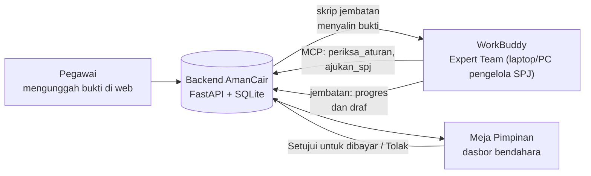
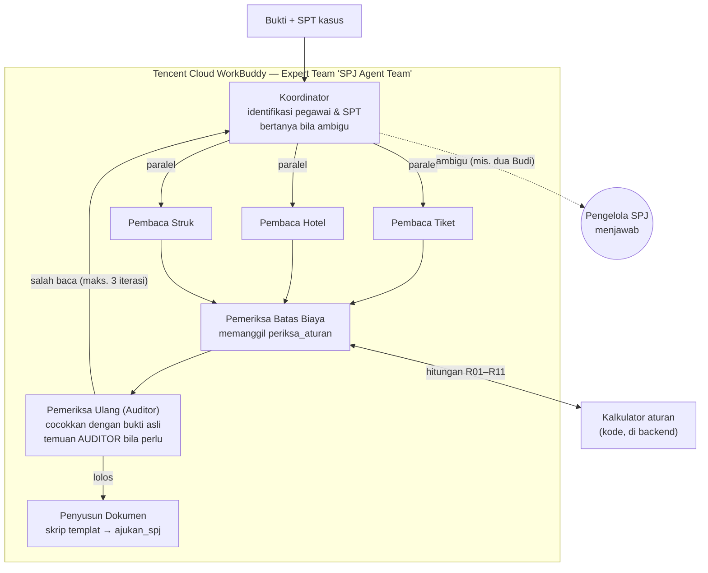
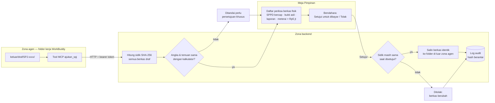

# Diagram Arsitektur — AmanCair

## 1. Alur dari pegawai sampai bendahara

## 2. Orkestrasi tim agen (di dalam WorkBuddy)

## 3. Batas kepercayaan dan gerbang persetujuan

**Garis batas:** agen hanya bisa menghitung lewat kalkulator dan *mengajukan*. Penyalinan berkas yang disetujui hanya dilakukan backend setelah bendahara mencentang daftar periksa dan menekan Setujui, ke folder di luar jangkauan WorkBuddy.

## 4. Komponen

| Komponen | Teknologi | Tanggung jawab |
|---|---|---|
| Tim agen | WorkBuddy Expert Team, 7 agen dengan instruksi masing-masing | Membaca, menilai, bertanya, memeriksa ulang, menyusun |
| Kalkulator aturan | Tool MCP `periksa_aturan` di backend | Hitungan R01–R11, struk ganda lintas SPJ, uang harian |
| Templat dokumen | `tools/susun_dokumen.py` (openpyxl, python-docx) | Rekap Excel, draf SPJ Word, ringkasan pemeriksaan bergaya dinas |
| Jembatan | `scripts/jembatan_workbuddy.py` | Mengambil pengajuan pegawai, mengirim progres agen, mengunggah draf |
| Backend | Python, FastAPI, FastMCP, SQLite, pytest (167 tes) | Gerbang SPJ, audit hash berantai, perbandingan dengan kalkulator |
| Meja Pimpinan | Next.js | Dasbor bendahara, halaman pegawai, papan proses pemeriksaan |
| Data demo | Excel/JSON/TXT/PDF fiktif | Pegawai, SBM, SPT, libur, 11 kasus bukti |

## 5. Keputusan desain & trade-off

| Keputusan | Alasan | Konsekuensi |
|---|---|---|
| Model untuk membaca dan menilai; kode untuk menghitung | Saat uji, model salah hitung, melewatkan aturan, dan menulis angka dari ingatan | Kasus selesai 4–9 menit (dulu 17–25); dua kasus yang dulu gagal kini lolos |
| Persetujuan di backend, bukan di agen | Agen pernah menyimulasikan kerja tim, menyalin versi berkas berbeda, dan menulis persetujuan atas nama bendahara meski dilarang | Backend dan konektor MCP harus berjalan |
| Pengajuan dibandingkan dengan hasil kalkulator | Agen tidak bisa diam-diam mengubah angka atau membuang temuan penting | Selisih apa pun membuat SPJ perlu persetujuan khusus |
| Auditor boleh menambah temuan berlabel `AUDITOR` | Ada hal yang tidak bisa dihitung kode; saat uji, Auditor justru menemukan dua celah di kalkulator | Temuan agen dan temuan kode dibedakan di layar |
| Daftar periksa berkas fisik oleh manusia | AI hanya melihat salinan digital, tidak bisa menjamin SPPD bercap atau bukti asli | Satu langkah tambahan untuk bendahara |
| Agen hanya jalan saat PC pengelola menyala | WorkBuddy adalah aplikasi desktop tanpa API masuk | Pengajuan pegawai menunggu di antrean sampai PC menyala; web tetap bisa diakses kapan saja |
| Sidik versi seluruh berkas | Persetujuan harus atas berkas yang persis sama | Revisi sekecil apa pun menjadi pengajuan versi baru |
| Data SBM fiktif dan disederhanakan | Panitia mengizinkan data dummy | Perlu diganti SBM resmi saat implementasi nyata |
