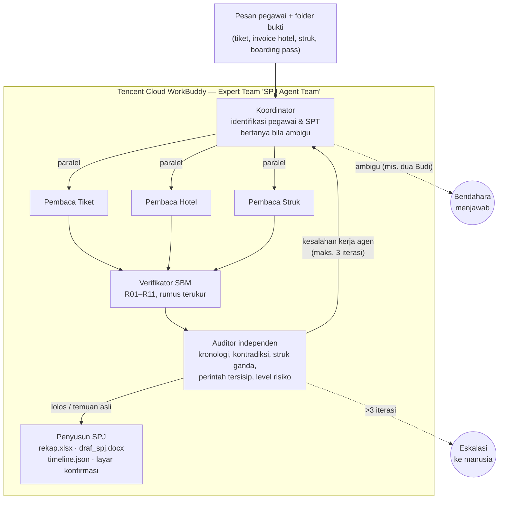
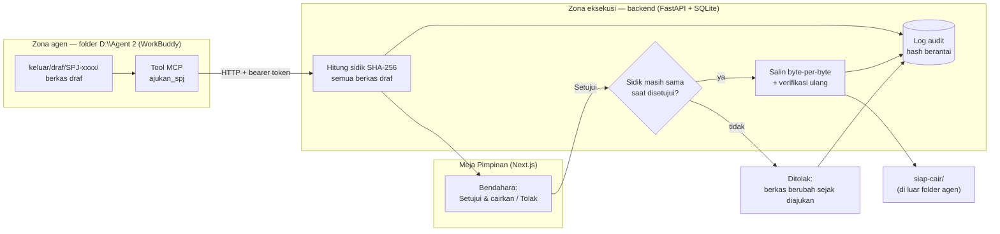

# Diagram Arsitektur — AmanCair

## 1. Orkestrasi tim agen (di dalam WorkBuddy)

## 2. Batas kepercayaan (trust boundary) dan gerbang persetujuan

**Garis batas:** semua di zona agen hanya bisa *mengajukan*. Penulisan ke `siap-cair/` hanya dilakukan backend setelah klik bendahara, dan folder itu berada di luar folder yang diizinkan untuk WorkBuddy.

## 3. Komponen
| Komponen | Teknologi | Tanggung jawab |
|---|---|---|
| Tim agen | WorkBuddy Expert Team + 7 SKILL.md | Memahami, membaca, memverifikasi, mengaudit, menyusun |
| Data demo | Excel/JSON/TXT/PDF fiktif | Pegawai, SBM, SPT, libur, 11 kasus bukti |
| Konektor | MCP streamable HTTP, bearer token per akun | `ajukan_spj` (+ tool baca) |
| Backend | Python, FastAPI, FastMCP, SQLite, pytest (137 tes) | Gerbang SPJ, audit hash berantai, aturan deterministik |
| Meja Pimpinan | Next.js | Antarmuka konfirmasi bendahara, mobile-first |

## 4. Keputusan desain & trade-off
| Keputusan | Alasan | Konsekuensi |
|---|---|---|
| LLM untuk memahami, kode untuk menghitung & mengeksekusi | Angka dan aturan harus bisa diulang dan diuji; LLM bisa salah hitung | Butuh skrip hitung dan formula Excel |
| Pencairan di backend, bukan di agen | Pengujian membuktikan agen bisa menyimulasikan kerja, menyalin versi berbeda, dan menulis persetujuan palsu bila diberi akses | Perlu menjalankan backend + konektor MCP |
| Sidik versi seluruh berkas (manifest) | Persetujuan harus atas berkas yang persis sama | Revisi sekecil apa pun → ajukan ulang (versi baru) |
| Temuan asli tidak masuk loop perbaikan | Mencegah agen berputar 3 kali tanpa hasil | Temuan langsung tampil ke bendahara |
| Deteksi ganda lintas kasus hanya berupa sinyal | Menjaga izin: agen tidak melihat isi kasus pegawai lain | Bendahara yang menelusuri pasangannya |
| Data dan aturan SBM fiktif & disederhanakan | Panitia mengizinkan data dummy; menghindari klaim regulasi yang belum diverifikasi | Perlu diganti SBM resmi saat implementasi nyata |
